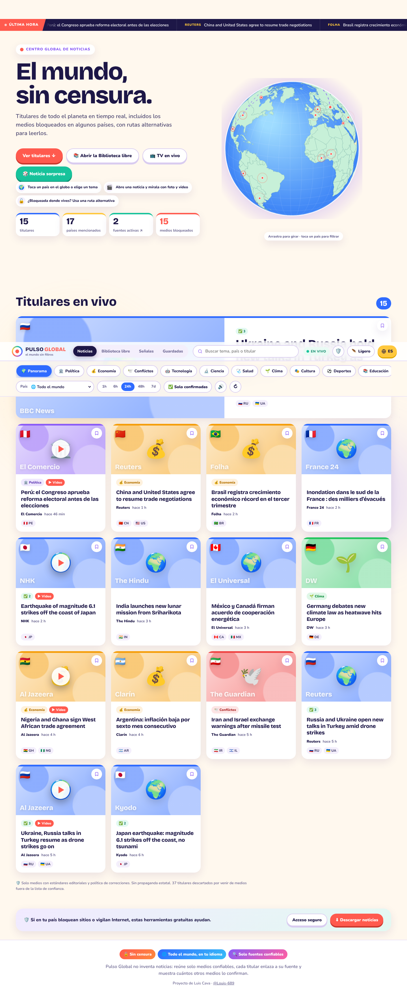
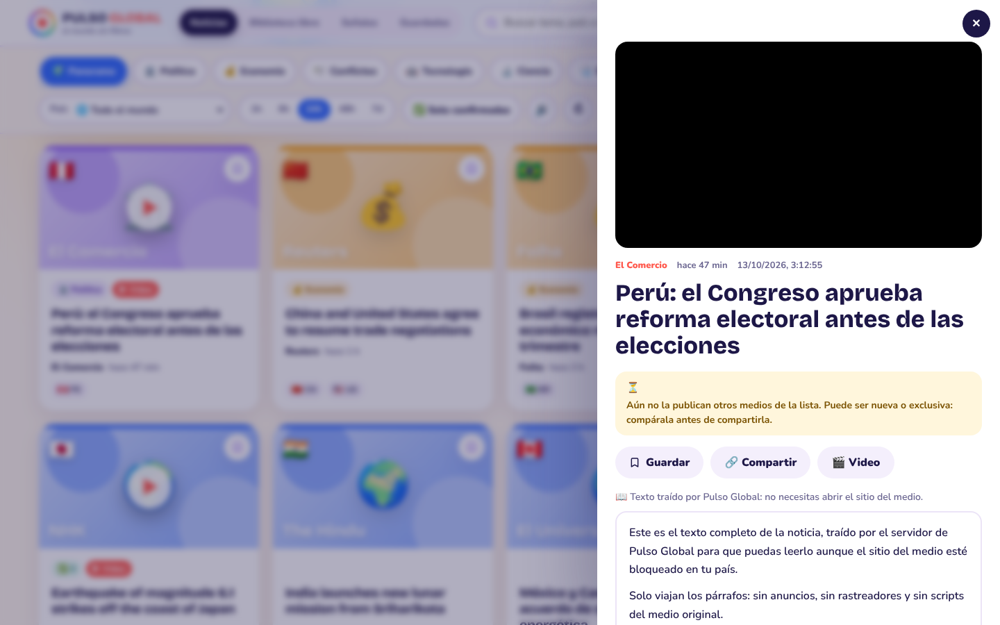
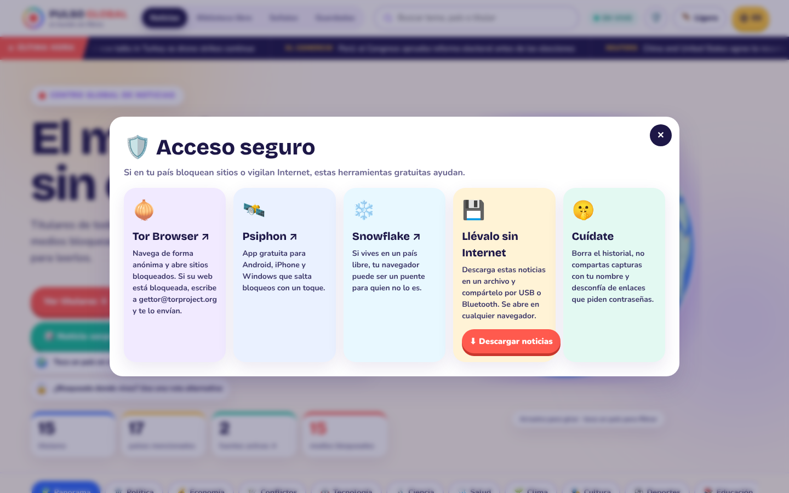
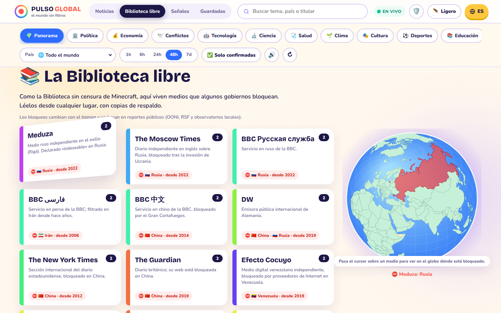
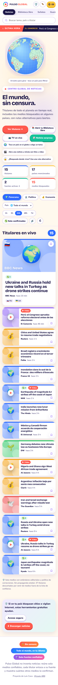
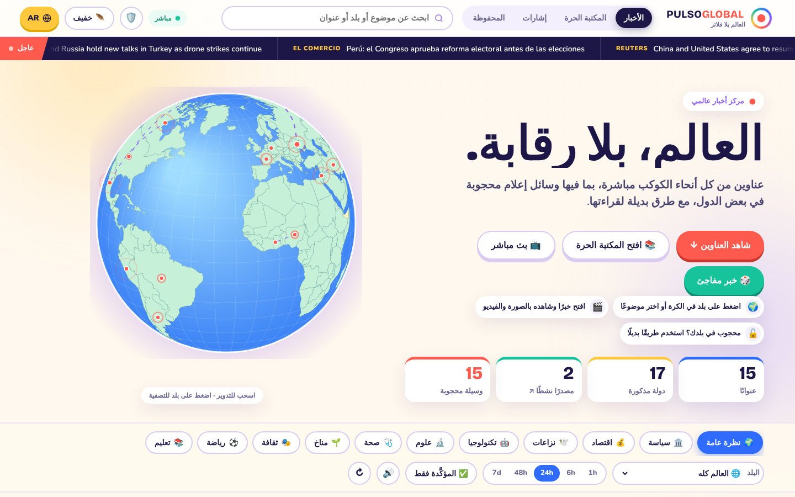

<div align="center">

# 🌍 Pulso Global

### El mundo, sin censura · *The world, uncensored*

**Un centro de noticias abierto, gratuito y multilingüe para quienes viven donde la información está bloqueada.**

[](LICENSE)
[](https://nextjs.org)
[](#-idiomas)
[](#-para-desarrolladores)
[](CONTRIBUTING.md)

[Español](#-por-qué-existe) · [English](#-english)



</div>

---

## 💡 Por qué existe

En muchos países no se puede leer la prensa extranjera, las redes sociales están cortadas y los medios independientes trabajan desde el exilio. Millones de personas solo reciben la versión oficial.

En 2020, Reporteros Sin Fronteras construyó la *Uncensored Library* dentro de Minecraft: una biblioteca con artículos prohibidos, escondida en un juego que nadie bloquea. **Pulso Global lleva esa idea a las noticias de cada día.**

## 🎯 Para qué sirve

- **Leer noticias reales de todo el mundo en tu idioma**, solo de medios con estándares editoriales.
- **Saber si una noticia está confirmada** por otros medios antes de creerla o compartirla.
- **Llegar a medios bloqueados en tu país** a través de rutas alternativas o del propio Pulso Global.
- **Llevarte las noticias sin Internet** y pasarlas por USB o Bluetooth.
- **Aprender a leer con ojo crítico**, con una guía en cada noticia.

## ✨ Qué hace

| | Función | Cómo ayuda |
|---|---|---|
| 🛡️ | **Solo fuentes confiables** | Cada titular se compara con una lista abierta de ~250 medios con política de correcciones: agencias, emisoras públicas independientes, diarios de referencia, periodismo en el exilio y verificadores. La propaganda estatal (RT, Sputnik, CGTN, Xinhua, TASS, PressTV, Telesur) queda fuera. |
| ✅ | **Confirmada por N medios** | Si otros medios de la lista publican la misma historia, la tarjeta lo muestra y el lector los nombra. El botón «Solo confirmadas» deja solo esas. |
| 📚 | **Biblioteca libre** | 15 medios bloqueados en al menos un país, más Global Voices: Meduza, The Moscow Times, BBC en ruso, persa y chino, Daily NK, IranWire, 14ymedio, Efecto Cocuyo, El Pitazo, Confidencial y más. El globo marca dónde está bloqueado cada uno. |
| 📖 | **Leer aquí** | El servidor trae el texto del artículo, así que basta con llegar a Pulso Global. Las imágenes también pasan por el servidor. |
| 🔓 | **Rutas alternativas** | Cada noticia ofrece la fuente original, una copia en Archive.org, otra en archive.today y el proxy de Google Translate. |
| 🪶 | **Modo ligero** | Sin imágenes, videos ni animaciones, para conexiones lentas, caras o vigiladas. |
| 🕵️ | **Desmentidos** | Verificadores de datos (Maldita, Chequeado, Full Fact, PolitiFact…) que desmontan bulos y propaganda, para quien vive donde tergiversan las noticias. |
| 🗣 | **Todo en tu idioma** | Las noticias llegan de ediciones y medios en el idioma elegido. Las de otros idiomas se traducen solas (en el propio navegador cuando es posible) y siempre puedes ver el original. |
| 💾 | **Sin conexión** | La app guarda las últimas noticias y abre aunque se caiga Internet. «Descargar noticias» crea un único archivo, traducido y con el texto completo de las principales noticias, para compartir. |
| 📶 | **Biblioteca Wi‑Fi sin Internet** | La computadora con Pulso Global guarda cada actualización y el texto completo de las noticias principales. Si se corta Internet, sigue mostrándolas, y los teléfonos conectados a su Wi‑Fi o a su punto de acceso la abren con la dirección o el código QR que aparece en 🛡️ y en la ventana del programa. |
| 📦 | **Sin Internet también llega** | El archivo de noticias puede viajar por USB o tarjeta SD (como el «Paquete Semanal» de Cuba), de teléfono a teléfono con Briar, o por satélite con Toosheh. Cada noticia tiene un **código QR** que otro teléfono lee con la cámara, sin red. La guía también explica la radio de onda corta y Wikipedia sin conexión (Kiwix). |
| 🧅 | **Acceso seguro** | Guía de Tor Browser (también por correo con GetTor), Psiphon y Snowflake, con consejos de seguridad. |
| 🌍 | **Globo interactivo** | Toca un país para ver sus noticias. Los arcos unen países que aparecen juntos en un titular. |
| 📺 | **TV en vivo** | Canales internacionales en directo (France 24, DW, Al Jazeera, euronews, NHK…), ordenados por tu idioma. |
| 🧠 | **Didáctica** | Lista «Lee con ojo crítico», «Otras miradas» sobre el mismo tema y 🎲 Noticia sorpresa. |

<table><tr>
<td></td>
<td></td>
</tr><tr>
<td></td>
<td> </td>
</tr></table>

## ⚙️ Cómo funciona

```
Fuentes públicas (RSS, Google News, GDELT)
        │
        ▼
 Servidor de Pulso Global ── filtra por la lista de confianza (lib/trusted.ts)
        │                  ── agrupa historias iguales de medios distintos (lib/verify.ts)
        │                  ── añade foto o video oficial del medio (lib/enrich.ts)
        ▼
 Tu navegador ── globo, tarjetas, lector, modo ligero y copia sin conexión
```

- No hay base de datos ni cuentas de usuario. Pulso Global no guarda quién lee qué.
- Lo que guardas (noticias marcadas, idioma) vive solo en tu navegador.
- Todo el código es abierto. Cualquiera puede revisar qué medios entran y por qué.

## 💻 Instalar y usar en tu computadora

Solo necesitas **Node.js 20 o superior**, que es gratis.

### Windows

1. Instala Node.js desde [nodejs.org](https://nodejs.org/es/download) (versión LTS, botón verde) y acepta todo con «Siguiente».
2. Descarga Pulso Global: botón verde **Code → Download ZIP** en esta página, y descomprímelo donde quieras.
3. Abre la carpeta y haz **doble clic en `iniciar.bat`**.
4. La primera vez tarda unos minutos en instalar y preparar todo. Luego se abre el navegador solo.

> Si Windows muestra «Windows protegió su PC», pulsa «Más información» → «Ejecutar de todas formas». Es el aviso normal para archivos descargados.

### Mac

1. Instala Node.js desde [nodejs.org](https://nodejs.org) (versión LTS).
2. Descarga el ZIP y descomprímelo.
3. Haz **doble clic en `iniciar.command`**. Si macOS lo bloquea, clic derecho → «Abrir».

### Linux

```sh
# Debian/Ubuntu: sudo apt install nodejs npm  (o usa nvm para una versión reciente)
git clone https://github.com/Louis-689/pulso-global-noticias.git
cd pulso-global-noticias
./iniciar.sh
```

### Desde una terminal (cualquier sistema)

```sh
npm install
npm run iniciar      # instala, prepara, inicia y abre el navegador
```

Para apagarlo, cierra la ventana negra (o pulsa `Ctrl + C`). La próxima vez arranca en segundos.

## 📱 Cómo usarlo

1. **Elige tu idioma** con el botón amarillo arriba a la derecha.
2. **Toca un país en el globo** o elige un tema (Política, Salud, Clima…).
3. **Abre una noticia.** Verás el sello ✅ si otros medios la confirman, y el botón 📖 **Leer aquí** para leerla sin salir.
4. ¿El medio está bloqueado? Usa las **rutas alternativas** del lector.
5. Pulsa **✅ Solo confirmadas** para ver únicamente noticias confirmadas.
6. ¿Conexión lenta o vigilada? Activa **🪶 Ligero**.
7. Pulsa **🛡️** para ver herramientas de acceso seguro y caminos sin Internet, o **⬇ Descargar noticias** para llevártelas en un archivo.
8. ¿Ves una noticia en otro idioma? Se traduce sola; **🌐 Ver original** muestra el texto del medio. El botón **🌐 +N en otros idiomas** suma las noticias del resto del mundo.
9. **▦ Código QR** en el lector: otro teléfono lo escanea con la cámara y recibe el titular, el resumen y el enlace sin Internet.
10. Desde el navegador del móvil puedes **instalarla como app**: menú → «Añadir a pantalla de inicio».

## 🌐 Publicarlo en Internet (y crear espejos)

Un solo sitio es fácil de bloquear. Cuantas más copias haya, más difícil es censurarlo.

- **Gratis en Vercel:** entra a [vercel.com](https://vercel.com), «Add New Project», elige este repositorio y pulsa Deploy. No necesita configuración.
- **En cualquier servidor con Node:** `npm ci && npm run build && npm start` (puerto 3000).
- **Como servicio onion de Tor:** en un servidor con la app en marcha, instala Tor y añade a `/etc/tor/torrc`:
  ```
  HiddenServiceDir /var/lib/tor/pulso/
  HiddenServicePort 80 127.0.0.1:3000
  ```
  Reinicia Tor. Tu dirección `.onion` aparece en `/var/lib/tor/pulso/hostname` y se abre con Tor Browser incluso donde Tor está filtrado (usando puentes Snowflake).
- Comparte las direcciones por canales difíciles de cortar, como el correo o la mensajería cifrada. Nunca pidas datos personales a quien lo usa.

## 🗣 Idiomas

Español, English, Português, Français, Deutsch, Italiano, Русский, العربية (de derecha a izquierda), 中文, 日本語 y हिन्दी. Al elegir un idioma, la portada muestra solo noticias en ese idioma, traídas de varias ediciones regionales y medios propios (BBC, France 24, DW, Noticias ONU…). Las noticias de otros idiomas se traducen automáticamente: primero con el traductor integrado del navegador (Chrome), que funciona sin enviar nada fuera; si no está, con el servidor de Pulso Global (MyMemory y, como respaldo, el traductor web de Google).

## 🤝 Cómo ayudar

- ⭐ **Dale una estrella** a este repositorio para que más gente lo encuentre.
- 🔁 **Compártelo** con periodistas, docentes y organizaciones de libertad de prensa.
- 🪞 **Publica un espejo** (ver arriba). Es la ayuda más valiosa.
- 📰 **Propón medios** para la lista de confianza o la biblioteca, con un enlace a su política editorial. Lee [CONTRIBUTING.md](CONTRIBUTING.md).
- 🌐 **Traduce** la interfaz a tu idioma (archivos `lib/i18n*.ts`).
- 🐛 **Reporta errores** en la pestaña *Issues*.

## 🧑‍💻 Para desarrolladores

```sh
npm install
npm run dev      # http://localhost:3000 con recarga en vivo
npm run check    # TypeScript + 33 pruebas
```

```
app/          página, estilos y APIs: /api/pulse (noticias), /api/read (texto), /api/img (imágenes)
components/   interfaz: pulso-app, globe, story-card, reader, live-tv, safe-access
lib/          trusted (lista de confianza), verify (confirmación), pulse-service (fuentes),
              pulse-data (lectura RSS/Atom), library (medios bloqueados), extract y safe-fetch
              (espejo), offline (archivo para compartir), i18n (11 idiomas)
scripts/      iniciar.mjs (lanzador para Windows, Mac y Linux)
tests/        pruebas con node:test
```

Tecnología: Next.js 16, React 19, TypeScript, GSAP 3 para las animaciones y d3-geo para el globo. Las fuentes tipográficas van incluidas, sin peticiones a Google.

## ⚖️ Límites honestos

- **Ninguna app puede garantizar que una noticia sea verdad.** Pulso Global garantiza de dónde viene: solo medios con estándares editoriales, siempre con enlace a la fuente y el número de medios que la confirman.
- La confirmación compara palabras y países de los titulares, así que puede fallar entre idiomas distintos.
- La traducción automática puede equivocarse. Por eso siempre está el botón «Ver original».
- Los bloqueos cambian con el tiempo. La biblioteca se basa en reportes públicos (OONI, RSF, VE sin Filtro).
- Usar herramientas para saltar la censura puede ser peligroso en algunos países. Cada persona conoce mejor sus riesgos.

---

## 🌍 English

**Pulso Global is a free, open-source, multilingual news hub for people who live where information is blocked.**

**Why.** In many countries foreign news and social media are blocked, and independent outlets work from exile. Inspired by Reporters Without Borders' *Uncensored Library* in Minecraft, Pulso Global does the same for everyday news.

**What it does**
- Shows only outlets with editorial standards, from an open list of about 250 (`lib/trusted.ts`). State propaganda is excluded.
- Marks each story as **"Confirmed by N outlets"** when other trusted outlets report it.
- Includes a **Free Library** of 15 outlets blocked somewhere (plus Global Voices), plus alternative routes to reach them (Archive.org, archive.today, Google Translate proxy).
- **Read here:** the server fetches the article text, so readers only need to reach Pulso Global. Images go through the server too.
- **Your language first:** the feed comes from editions and outlets in the language you pick; stories in other languages are machine-translated (on-device in Chrome when available), always with the original one tap away.
- **Fact checks:** a section with IFCN fact-checkers that debunk rumors and propaganda.
- **Lite mode**, **offline reading**, and a single-file **news package** (translated, with full text of the top stories) to pass on by USB, SD card, Briar or satellite datacasting such as Toosheh. Every story also has a **QR code** another phone can scan with no Internet.
- A **Wi‑Fi library**: the computer running it keeps the latest news and full texts on disk, keeps serving them when the Internet is cut, and phones on its Wi‑Fi or hotspot open it at the address or QR shown in the app.
- A **safe access** guide (Tor, Psiphon, Snowflake) and ways news travels with no Internet at all (satellite, phone-to-phone mesh, shortwave radio, Kiwix).
- Interactive globe, live TV and 11 UI languages.

**Run it on your computer** (Windows, macOS, Linux). Install [Node.js](https://nodejs.org) 20+, download this repo (*Code → Download ZIP*), then:
- **Windows:** double-click `iniciar.bat`.
- **macOS:** double-click `iniciar.command`.
- **Linux:** run `./iniciar.sh`.
- **Any terminal:** `npm install && npm run iniciar`.

The browser opens automatically.

**Host a mirror.** Deploy to Vercel in one click, run `npm ci && npm run build && npm start` on any Node server, or publish it as a Tor onion service (see the Spanish section above for the `torrc` lines). Every mirror makes censorship harder.

**Contribute.** Star the repo, share it, host a mirror, propose outlets (with their editorial policy), translate the UI, or report bugs. See [CONTRIBUTING.md](CONTRIBUTING.md).

**Honest limits.** No app can guarantee truth. Pulso Global guarantees where each story comes from and how many trusted outlets confirm it.

---

<div align="center">

Creado por **Luis Alejandro Cava Vassi** ([@Louis-689](https://github.com/Louis-689)) · Licencia [MIT](LICENSE)

*Si este proyecto te parece útil, dale una ⭐ y compártelo. Cada copia cuenta.*

</div>
